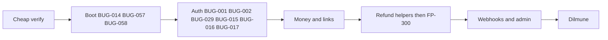

# FilsPay verify-then-fix plan

Follow [finance_ops_security_audit.md](finance_ops_security_audit.md) Document 2: **AUDIT** (done) → **FIX** (smallest change) → **EXPLAIN** (already in `Evidence/bugs/`) → **BUILD** (refunds + Dilmune).

**Bug numbering:** All bug references use the current `BUG-NNN` IDs in [bugs/Readme.md](bugs/Readme.md). Historical IDs are mapped in [bugs/BUG_MERGE_AUDIT.md](bugs/BUG_MERGE_AUDIT.md). The OTP and payment-link RNG reports are merged into BUG-029; the migration and refund-summary join reports are merged into BUG-014.

**Proof is the code.** Fatima’s tickets and YA-before-Feb / ADR-0001 are leads. Ignore MK cover (ADR-0003/0004/0006, ADMIN.md “cannot break the books”, May postmortem, agent files, locked tests that encode the wrong fils) as reasons to skip a fix *or* to invent one.

## Rules for every fix

- One behaviour per change. Prefer a predicate, a function swap, or a unique index over a rewrite.
- Do **not** “freeze” `packages/money`: call `parseBhdToFils` / `allocateRemainder`; do not reintroduce floats or 2-decimal parsing.
- Existing tests that assert the **bug** (CSV `475` fils for `4.75` BD, OTP pending accepted, etc.) are part of the defect. Update those expectations and add `*.new.test.ts` / extra Go cases for the correct rule. Do not treat `npm test` green-on-HEAD as a verifier.
- After each cluster: the cheapest check from the verify playbook (grep / snippet / one curl). Do not full-compose until BUG-014 + BUG-058 work.

## Phase 0 — Cheap verify (do not fix yet)

**Completed:** all 69 findings scoped by this plan remain open. Verification and corrections are recorded in [infrastructure](phase0/agent-1-infrastructure.md), [auth/admin](phase0/agent-2-auth-admin.md), [payments/refunds](phase0/agent-3-payments-refunds.md), [settlement](phase0/agent-4-settlement.md), [webhooks](phase0/agent-5-webhooks.md), and [reporting](phase0/agent-6-reporting.md). Use those current code findings over stale subclaims in canonical reports. This is not coverage of all 84 registry entries.

For each candidate: drop MK-only leads; confirm file:line still matches HEAD; skip rows already `runtime`/`sample` unless you are about to patch them.

Stop if the code no longer matches the note. Do not spend HTTP on parsers, views, or missing indexes.

**Already proven, fix without re-demo:** BUG-001, BUG-029 (OTP portion), BUG-005, BUG-006, BUG-009, BUG-011, BUG-038, BUG-012, BUG-013, BUG-047, BUG-048, BUG-050, BUG-040, BUG-004, BUG-042, BUG-014, BUG-044, BUG-082.

## Phase 1 — App must boot

Without this, Dilmune and `docker compose` score nothing.

1. **BUG-014** — Edit [`db/migrations/0054_views.sql`](../db/migrations/0054_views.sql): replace `settlement_batch_events` with `te.settlement_batch_id IS NULL` (column from 0023). Edit [`db/migrations/0055_chart_of_accounts_suspense.sql`](../db/migrations/0055_chart_of_accounts_suspense.sql) to use `(id, name, kind)`, conflict target `id`, and valid `asset` / `liability` / `revenue` kinds matching 0007; `suspense` is not a valid kind. Fix [`db/migrations/0072_refund_merchant_summary.sql`](../db/migrations/0072_refund_merchant_summary.sql) join to `r.transaction_id`. In-place changes support fresh/unapplied databases only. Inspect applied filenames before any existing-database rollout; recorded objects need corrective forward migrations. Keep the summary's repeated capture totals and missing refresh ownership as separate refund/reporting integration work.
2. **BUG-057 / BUG-058** — Add missing `ops/Dockerfile.node` and `ops/Dockerfile.go`; explicitly inject local environment configuration into API; provide a valid 32-byte webhook encryption key and the same nonempty `SETTLEMENT_INTERNAL_TOKEN` to API and daemon. Replace tracked secret configuration with a value-free template and ignore local secrets. The invalid webhook key is in the API fallback, not the environment file. Previously exposed external credentials require rotation by their owner; removing a file does not rotate them.
3. **BUG-054 prerequisite** — Guard destructive seeding at `db/seed/generate.ts`, before any reset, with explicit `ALLOW_DESTRUCTIVE_SEED=1` and an allowlisted local/dev destination. Ordinary startup must not reset existing data. Migrations must succeed before optional seed execution; services must not race migration/seed jobs. Remove the redundant Compose `PGCONN_SETTLEMENT` override without changing intentional Go override support (BUG-080 remains separate).
4. Prove on a disposable empty database: `npx tsx db/migrate.ts` reaches 0072; a second run is a no-op; images build, API health responds, and settlement accepts the configured internal token while rejecting a wrong token. Verify seed refusal without opt-in and successful explicitly requested local seeding. Do not reset an existing user database.

### Current implementation wave and ownership

- Migration agent: BUG-014; owns 0054/0055/0072 and migration regression checks. One coordinator allocates any new migration numbers; BUG-081 checksum/locking work is deferred.
- Boot/config agent: BUG-057/058 and BUG-054 prerequisite; owns Dockerfiles, Compose, environment templates, API config fallback, and seed guard. No credential values in reports or commits.
- Auth agent: BUG-001/002/015/016/017/029; owns session/OTP/user/key-verification helpers, auth routes, shared RNG, payment-link token generation, and focused regressions. Enforce authentication in the session lookup so this wave needs no live-session view migration.
- These agents may implement in parallel with disjoint file ownership. The coordinator reviews changes, runs the boot and auth gates, and updates canonical fix notes. Refund activation and later phases are outside this wave.

## Phase 2 — Auth (OTP actually protects)

| Bug | Smallest fix | Files |
|---|---|---|
| BUG-001 | `AND authenticated = true` in `lookupSession` (or the view) | [`apps/api/src/auth/sessions.ts`](../apps/api/src/auth/sessions.ts), [`db/migrations/0058_live_sessions.sql`](../db/migrations/0058_live_sessions.sql) |
| BUG-002 | Drop `findOtpRecipient`; use the login `user` row | [`apps/api/src/routes/auth.ts`](../apps/api/src/routes/auth.ts), [`apps/api/src/auth/users.ts`](../apps/api/src/auth/users.ts) |
| BUG-029 | `crypto.randomInt` in `randomDigits` / `randomFromAlphabet`; payment-link token via `randomToken` | [`apps/api/src/lib/random.ts`](../apps/api/src/lib/random.ts), [`apps/api/src/paymentLinks/create.ts`](../apps/api/src/paymentLinks/create.ts) |
| BUG-015 | `SELECT … FOR UPDATE` or atomic increment; copy `attempt_count` on resend | [`apps/api/src/routes/auth.ts`](../apps/api/src/routes/auth.ts), [`apps/api/src/routes/adminAuth.ts`](../apps/api/src/routes/adminAuth.ts) |
| BUG-016 | New token on `promoteSession`; re-set cookie with full TTL | [`apps/api/src/auth/sessions.ts`](../apps/api/src/auth/sessions.ts) |
| BUG-017 | Join `merchants.status = 'active'` in session + API-key lookup | [`apps/api/src/auth/sessions.ts`](../apps/api/src/auth/sessions.ts), [`apps/api/src/apiKeys/verify.ts`](../apps/api/src/apiKeys/verify.ts) |

Curl: login without OTP → `/v1/auth/me` is 401. Verify merchant/admin token rotation and full cookie TTL after OTP, concurrent attempt limits and resend budget carry-forward, password-checked tenant identity, suspended-merchant rejection, and API-key `revoke_after` expiry. BUG-004 impersonation write denial remains a prerequisite before refund activation.

## Phase 3 — Payment links and capture

| Bug | Smallest fix |
|---|---|
| BUG-005 | Public pay ignores `submittedAt` (always server now) in [`apps/api/src/paymentLinks/pay.ts`](../apps/api/src/paymentLinks/pay.ts) / route |
| BUG-006 | Durable operation identity plus reservation fencing and outcome recovery; an ambiguous/successful external capture must not be retried blindly or compensated with an authorization void. Successful capture compensation requires refund/reconciliation |
| BUG-018 | `AND merchant_id = $2` in [`apps/api/src/paymentLinks/cancel.ts`](../apps/api/src/paymentLinks/cancel.ts) |
| BUG-022 | Remove `api_keys` hash from public read DTO |
| BUG-023 | Call `applyCaptureDiscountAdjustment` from pay path (or inside `captureTransaction`) |
| BUG-024, BUG-025, BUG-061 | Acquirer reverse on void; capture checks hold expiry without inventing an unsupported transaction status; add durable reservation/recovery before moving acquirer I/O outside the long DB txn (keep `FOR UPDATE` in short txns) |

## Phase 4 — Money / settlement (ADR-0001)

Ignore ADR-0003/0004/0006. Restore YA rules.

| Bug | Smallest fix |
|---|---|
| BUG-009 | `parseBhdToFils` in [`apps/api/src/admin/adjustmentCsvParsing.ts`](../apps/api/src/admin/adjustmentCsvParsing.ts) |
| BUG-010 | `return grossFils - feeFils` in [`apps/settlement/internal/settlement/payable.go`](../apps/settlement/internal/settlement/payable.go) |
| BUG-034 | Persist scheme `amount` from **truncated** fils; post `gross - truncated` to `scheme_rounding_residue` in CloseBatch (ADR-0002 decision) |
| BUG-011 | `handleRebuildBalances` → `RebuildAllBalances` (ledger), not `RefreshBalanceCache` ([`apps/settlement/internal/internalapi/server.go`](../apps/settlement/internal/internalapi/server.go)) |
| BUG-038 | Route Adjust to `adjustMerchantBalanceJournaled` |
| BUG-035 | MDR recalc only `status = 'closed'` (never paid) |
| BUG-030 | Largest-remainder / port `allocateRemainder` in [`apps/settlement/internal/splits/allocate.go`](../apps/settlement/internal/splits/allocate.go) |
| BUG-071 | Display uses `getEffectiveMdrBps(..., now)` |
| BUG-036 | `BusinessDayWindow`: convert `date` to `businessDayLocation` **before** `Date()`; daemon uses Bahrain “now” |
| BUG-032 | One fee formula (discount amount then MDR) in TS and Go |
| BUG-013 | Empty id list → no-op; `UPDATE … expired` not `DELETE FROM holds` ([`scripts/lib/sqlFilter.ts`](../scripts/lib/sqlFilter.ts), [`scripts/expire_holds.ts`](../scripts/expire_holds.ts)) |
| BUG-033 | Document “do not run” for the current March sweep: its amounts/accounts differ from scheme-line residue. BUG-034 fixes new closes only; any historical backfill needs correct amounts/accounts, Bahrain bounds, deterministic identity, and exclusion of already-posted batches |
| BUG-031, BUG-063 | BIGINT / int64 counters |

Snippet: `parseDecimalMinor` gone from CSV; `4.75` → 4750 fils.

## Phase 5 — Refunds then FP-300 (BUILD)

Fix helpers **before** removing the 501.

| Bug | Smallest fix |
|---|---|
| BUG-007 | `refundableFils = captured - refunded` in [`apps/api/src/payments/processRefund.ts`](../apps/api/src/payments/processRefund.ts) |
| BUG-008 | Persist pending amount/operation intent before external I/O, serialize with other payment operations, finalize once, and increment `refunded_fils` conditionally within the captured cap; a finalization lock alone does not prevent duplicate external refunds |
| BUG-003 | `txn.merchant_id !== input.merchantId` → 404 |
| BUG-028 | Normalize reason before external I/O; atomically claim retries and preserve durable external-outcome recovery. A database failure after approval must not become a blind retry or deleted claim |
| **BUG-027** | Wire [`apps/api/src/routes/refunds.ts`](../apps/api/src/routes/refunds.ts) (and merchant-scoped path the drawer uses) to `initiateMerchantRefund` + idempotency header |
| BUG-045 | Sign and send the **same** body string (`canonicalJson` once) in [`apps/api/src/webhooks/dispatcher.ts`](../apps/api/src/webhooks/dispatcher.ts) |
| Webhook type | Add `refund.succeeded` to `WEBHOOK_ELIGIBLE_EVENT_TYPES` **and** `envelope.ts` (YA comment: type without envelope stalls the queue) |

FP-300 done-when: API round-trip, ledger balanced to the fils, fees/payouts, merchant webhook, timeline + reports (fix BUG-052 / BUG-074 / BUG-014 so rollups are honest). Uncomment [`apps/web/src/pages/transactions/RefundDrawer.tsx`](../apps/web/src/pages/transactions/RefundDrawer.tsx).

Keep the route at 501 until authorization (including BUG-004), pending reservations, external-operation recovery, historical net-fee basis, cumulative fee reversal rounding/caps, and exactly-once settlement adjustments are validated. Wire refund selection AND dispatch in reporting, compatible rollup schema, Bahrain dates, shared replay/backfill, API totals, and stable UI operation keys. Aggregate capture and refund streams separately; correct 0072's join without multiplying captured totals across partial refunds, and assign refresh ownership. Ledger balance alone does not prove economically correct reversals. BUG-026 and BUG-065/066 are cross-registry dependencies to review during that integration, not findings already covered by this plan's Phase 0.

## Phase 6 — Webhooks and admin (high score, small diffs)

- **BUG-047, BUG-048:** Require callback signatures in non-dev; `UNIQUE (callback_id)` + `ON CONFLICT DO NOTHING`.
- **BUG-049:** Partial unique index on `outbox_events (aggregate_id) WHERE event_type = 'settlement.paid'` plus conflict-safe insert. Do not impose global `(event_type, aggregate_id)` uniqueness: multiple partial captures/refunds share a transaction aggregate. Reconcile existing duplicates before adding uniqueness.
- **BUG-050:** Record disbursement with the ledger movement in both normal and split payout paths; remove dispatcher `PRE_DELIVERY_EFFECTS`; unique batch id. Coordinate split conservation and reconcile existing duplicate disbursements before index creation.
- **BUG-068:** Replay keeps original `delivery_event_id` or skips pre-delivery effects.
- **BUG-039:** `revoked_at = now()` on old key in [`apps/api/src/admin/apiKeys.ts`](../apps/api/src/admin/apiKeys.ts).
- **BUG-040:** Compare `adminUserId` in [`apps/api/src/admin/creditApproval.ts`](../apps/api/src/admin/creditApproval.ts).
- **BUG-041:** `requireAdminRole("finance","super_admin")` on credit create.
- **BUG-004:** Impersonation always merchant `support`; deny capture/void/keys when grant present.
- **BUG-042:** Bulk KYC `WHERE onboarding_status = 'under_review'` + review row.
- **BUG-012:** Never auto-clear `test_mode` from recompute.
- **BUG-046, BUG-051, BUG-019, BUG-053, BUG-020, BUG-044, BUG-037:** raw-body HMAC; deny private webhook URLs; parent-scoped split child; composite export cursor; reporting auth hook; CSV import idempotency; refuse close of today/future.

**Reporting corrections:** BUG-052 already commits each pass atomically; serialize concurrent consumers and establish commit-safe event consumption/failure recovery. BUG-074's admin rebuild already runs in one transaction: align replay sources and cursor under the same serialization protocol before historical recovery; an arbitrary `MAX(id)` cutoff is unsafe with late producer commits. BUG-071's confirmed display caller is admin merchant detail. BUG-053's timestamp-only pagination helper is latent; current HTTP uses the full builder. For BUG-082, remove the progress bar with no meaningful ratio rather than changing a divisor without a progress specification. Preserve these scope qualifications when writing regressions.

## Phase 7 — Remaining (if time)

Remaining work (BUG-061, BUG-072, BUG-075, BUG-073, BUG-055, BUG-079, BUG-064, BUG-069, BUG-080, BUG-081, BUG-076, BUG-082): same smallest-fix rule, after P0–P6 unless a dependency above requires it earlier. BUG-054 is promoted to Phase 1 for safe startup. Do not block Dilmune on unrelated backlog. BUG-055 must preserve or replace the existing audit outcome/metadata completion writer; a blanket audit UPDATE ban breaks it. Validate BUG-073 query plans before choosing indexes.

## Phase 8 — Host on Dilmune Cloud

After BUG-014 + BUG-058 + BUG-057: compose (or Dilmune’s equivalent) with migrate, seed **guarded** (BUG-054: refuse unless `ALLOW_DESTRUCTIVE_SEED`), API, settlement, reporting, web, admin. Confirm `/healthz`, merchant login+OTP, one payment-link pay, one refund, one webhook signature that verifies on the raw body.

## EXPLAIN

Keep [bugs/Readme.md](bugs/Readme.md) as the scoring notes. When a fix lands, add a one-line **Fixed** status + commit/path; do not rewrite the “what’s wrong / why / what it breaks” body.

## Suggested first PR-sized slices

1. Migrations 0054/0055/0072 (BUG-014) + compose/Dockerfiles (BUG-058, BUG-057)
2. Auth cluster (BUG-001, BUG-002, BUG-029, BUG-015, BUG-016, BUG-017)
3. CSV + net payout + rebuild button + expire_holds (BUG-009, BUG-010, BUG-011, BUG-013)
4. Payment links (BUG-005, BUG-006, BUG-018, BUG-023)
5. Refund helpers + route + webhook sign-raw (BUG-007, BUG-008, BUG-003, BUG-027, BUG-045)
6. Admin/webhooks (BUG-047, BUG-048, BUG-049, BUG-050, BUG-068, BUG-051, BUG-039, BUG-040, BUG-041, BUG-004, BUG-012, BUG-042)
