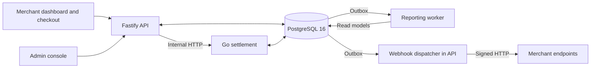

# FilsPay

FilsPay is a Bahraini Dinar (BHD) payment platform with a merchant dashboard, hosted checkout, payment links, refunds, settlement, reporting, and an operations console.

**FilsPay Hackathon · Team Cherry Pickers 🍒**

This repository contains the application, our hackathon improvements, and their supporting investigation. We traced failures across the UI, API, database, and workers, challenged historical assumptions, and documented the results.

[Architecture](#architecture) · [AI workflow](#ai-assisted-engineering) · [Evidence](#evidence) · [Run locally](#running-the-project)

## What We Investigated

The work covered four connected areas:

- **Access and security:** merchant/admin authentication, OTP and authenticator lifecycles, session boundaries, roles, tenant isolation, API keys, and webhook verification.
- **Payment and financial behavior:** authorization, capture, voids, full/partial refunds, single-use links, integer BHD/fils handling, CSV exports, balances, payout splits, and settlement windows.
- **Runtime and operations:** service integration, reporting projections, deployment, reverse-proxy behavior, concurrency, overload, and recovery.
- **User experience:** checkout validation and retry feedback, merchant/admin navigation, responsive layouts, accessible tables, and consistent financial presentation.

The [Git-history dossier](Evidence/codecheck/FilsPay_Git_Commit_and_Code_Comments_Evidence.md) also investigates source comments, historical decisions, and the hackathon's **“Order of the Prompt”** puzzle. Its narrative is distinct from reproduced software defects.

## Key Improvements

These examples appear in current source and the linked reports. **Verification is scoped to each report's recorded revision and environment.**

| Area | Change | Evidence and verification scope |
| --- | --- | --- |
| Checkout and payment links | Added card validation/formatting, stable retry keys, expiry admission checks, three-decimal BHD input, and bounded server-relative expiration controls. | [Checkout report](Evidence/payment_checkout_enhancements.md): baseline regressions, browser checks, and an isolated API/Postgres simulator payment. |
| Webhooks | Added `payment.failed` and `payment_link.expired`, bounded exception retries, capped jitter, and aligned capture lock order. | [Webhook audit](Evidence/webhook_audit_and_implementation.md): database, signed HTTP, concurrency, rollback, and restart-recovery checks. |
| Financial handling | Corrected BHD CSV parsing, used ledger data for console balance rebuilds, and conserved payout splits through largest-remainder allocation. | [Parser verification](Evidence/POST_MERGE_AUDIT_REPORT.md); [split-unit verification and rebuild database limits](Evidence/balance_reconciliation_fix.md). |
| Operational safety | Removed the retired March reconciliation script's database/posting code; direct execution refuses to run. | [PMA-08 validation](Evidence/PMA-08_RECONCILIATION_SAFETY_FIX.md): execution prevention verified; historical financial impact unverified. |
| Merchant/admin UI | Added shared components, responsive layouts, clearer states, and named, keyboard-focusable table regions. | [UI report](Evidence/ui_ux_redesign.md): render/accessibility regressions and builds; broader visual/browser checks limited. |

Authentication evolved through email-OTP work, authenticator enrollment/recovery, and restricted test-console OTP; consult the [merchant](apps/api/src/routes/auth.ts) and [admin](apps/api/src/routes/adminAuth.ts) handlers for current policy. Refund, reporting, and settlement work does not establish complete reconciliation or live-provider correctness.

## Architecture

The services share one PostgreSQL database. The API serves the merchant, public checkout, and separate admin planes; settlement exposes an authenticated internal HTTP interface. Reporting and webhook delivery consume committed outbox events, with PostgreSQL `LISTEN/NOTIFY` providing wake-ups.



Core design rules visible in the implementation:

- **Integer money:** 1 BHD = 1,000 fils. The protected [`packages/money/`](packages/money/) provides parsing, formatting, rates, and allocation; Go maintains its own integer-money implementation.
- **Ledger and cache:** ledger legs share an `entry_group_id`, with balance enforced by a deferred database trigger. `merchant_balances` is a derived cache.
- **Transactional events:** domain writes enqueue outbox records within database transactions; reporting applies projections and advances its cursor transactionally.
- **Business and access boundaries:** settlement uses Asia/Bahrain days. Merchant/admin sessions are separate, and server-side authentication and role checks protect their routes.

The registered payment acquirer is an **in-process simulator**. An optional deterministic adapter is restricted to test-merchant hosted checkout; neither adapter constitutes a live payment-provider integration.

See [architecture documentation](docs/ARCHITECTURE.md), [dependencies](context/DEPENDENCY_MAP.md), and [decision context](context/DECISIONS.md). Historical descriptions can disagree with current code.

## Tech Stack

| Layer | Repository implementation |
| --- | --- |
| Runtime and organization | Node.js 22, TypeScript ESM, npm workspaces; standalone Go settlement module |
| Frontends | React 18, React Router 6, Vite 5, shared CSS/components in `apps/ui` |
| API and authentication | Fastify 5, `pg`, Argon2 password hashing, `otplib` TOTP, local QR generation |
| Database and messaging | PostgreSQL 16 in Compose, SQL migrations, transactional outbox, `LISTEN/NOTIFY` |
| Settlement | Go, `pgx/v5`, integer accounting, batch/payout/export commands |
| Operations | Docker/Compose, separate production templates, Nginx static-SPA serving and API reverse proxy |
| Verification | Node test runner through `tsx`, Fastify injection tests, Go tests, opt-in Chromium/CDP checkout harness |
| Load tooling | Custom Node HTTP runner and fixtures, isolated Compose stack, SQL integrity checks |

## AI-Assisted Engineering

> **AI was an investigation tool — not the judge.**

The team used **Cursor, Claude / Claude Code, Google Gemini, and OpenAI Codex** for navigation, hypotheses, flow tracing, implementation, tests, debugging, and review. Findings required inspection and reproduction; model confidence was not acceptance evidence.

The repository preserves these workflow roles:

| Tool | Repository-supported role |
| --- | --- |
| Cursor | Focused editing and project navigation under the [Cursor rules](.cursor/rules/filspay.mdc). |
| Claude / Claude Code | Research, implementation, and verification governed by [`CLAUDE.md`](CLAUDE.md). |
| Google Gemini | Source exploration, context-aware analysis, and verification governed by [`GEMINI.md`](GEMINI.md). |
| OpenAI Codex | Engineering and runtime investigation under [`AGENTS.md`](AGENTS.md); concurrent Codex runtime work is recorded in the [source-investigation dossier](Evidence/codecheck/FilsPay_Complete_Source_Code_Investigation.md). |

These records document guidance and reported activity; they do not establish model-by-model authorship or independent validation of every fix.

A concrete lesson was the March reconciliation script: a retirement comment did not stop execution. The [follow-up](Evidence/PMA-08_RECONCILIATION_SAFETY_FIX.md) traced the executable path, removed posting capability, and added safety regressions. An earlier “fixed” label needed to be challenged against behavior.

## Context Engineering

Agents received project-specific constraints and subsystem context:

- [`AGENTS.md`](AGENTS.md) defines shared safety, financial, Git, and verification rules, including protected money code and partner contracts.
- [`CLAUDE.md`](CLAUDE.md), [`GEMINI.md`](GEMINI.md), and the Cursor rules add tool-specific working guidance.
- [`context/README.md`](context/README.md) routes tasks to module descriptions, dependencies, decisions, known issues, and testing records.
- [`docs/`](docs/) holds architecture, ADRs, and operational material; [`Evidence/`](Evidence/) holds investigations and validation results.

Context supports continuity; source checks remain essential because descriptions, historical decisions, and report baselines can disagree.

## Evidence-Driven Workflow

**Discover → Reproduce → Trace → Fix → Test → Verify → Document**

The intended standard was a confirmed defect, a minimal change, a failing regression, and verification of the affected path. Compilation or an AI recommendation alone did not complete it.

Reports collect source inspection, tests, API/browser behavior, database queries, logs, and before/after comparisons. They distinguish implementation, verification, blocked checks, and open questions. Historical findings remain leads rather than current proof.

## Testing & Verification

From the repository root:

```sh
npm run typecheck
npm test
npm run build -w @filspay/web
npm run build -w @filspay/admin
```

For native settlement checks, run from `apps/settlement/`:

```sh
go test ./...
go build ./cmd/settlement
```

API/reporting integration suites require `DATABASE_URL` for an **isolated, migrated test database**. Read the [testing guide](context/TESTING.md) and test setup first. Go suites can skip database tests without configuration.

The [checkout](Evidence/payment_checkout_enhancements.md), [webhook](Evidence/webhook_audit_and_implementation.md), and [hosted demo](Evidence/demo_payment_checkout.md) reports document successful scoped checks. Other reports record failures and incomplete suites. These historical results do not establish a full-suite or end-to-end pass on the latest working tree.

## Load & Capacity Testing

The custom [`checkout-capacity.mjs`](scripts/checkout-capacity.mjs) supports closed-loop users and fixed-arrival traffic, recording latency percentiles, paid/completed requests, errors, and generator limits. The prepared [`ops/capacity/`](ops/capacity/) stack includes resource caps, Nginx, and SQL checks.

The [load report](Evidence/capacity_checkout_load_test.md) records historical throughput, overload, and recovery. Its 31 October 2026 entry states that **current-build capacity remains unmeasured**: the isolated Docker run could not start. Runner-fixture tests passed; they do not measure application throughput or demonstrate a capacity improvement.

## Repository Structure

```text
apps/
  api/          Fastify API, payments, authentication, webhook delivery
  web/          Merchant dashboard and public /pay/:token checkout
  admin/        Operations console
  settlement/   Go settlement daemon and CLI
  reporting/    Outbox-driven analytics worker
  ui/           Shared frontend components and styles
packages/
  money/        Protected integer-fils helpers
  events/       Event types and transactional enqueue helper
db/             SQL migrations, runner, isolated fixture tooling
ops/            Local/production Compose, Nginx, preview and capacity tools
scripts/        Operational utilities and regression/load tools
context/        Persistent engineering context
docs/           Architecture, ADRs, and runbooks
Evidence/       Findings, investigations, and verification reports
```

## Evidence

- [Bug registry](Evidence/bugs/Readme.md): findings and revision-specific status records.
- [Implementation records](Evidence/implementation/): subsystem validation and supporting artifacts.
- [Repository investigation](Evidence/codecheck/): source, Git-history, and forensic analysis with stated provenance and limits.
- [Post-merge audit](Evidence/POST_MERGE_AUDIT_REPORT.md): a historical assessment to read alongside later remediation reports.

## Running the Project

Prerequisites: **Node.js 22, npm, and Docker with Compose v2**. Docker builds settlement; native Go development needs a compatible local toolchain.

From the root:

```sh
npm install
node ops/setup-env.mjs
docker compose -f ops/docker-compose.yml up --build -d
```

The setup script preserves existing local keys. Compose starts PostgreSQL, applies migrations, and starts API, reporting, and settlement. Normal startup does not seed or reset data. Start the frontends in a second terminal:

```sh
node ops/preview.mjs
```

| Local service | Default URL |
| --- | --- |
| Merchant dashboard | [localhost:5173/dashboard/login](http://localhost:5173/dashboard/login) |
| Admin console | [localhost:5174/login](http://localhost:5174/login) |
| API liveness | [localhost:3000/healthz](http://localhost:3000/healthz) |

See the [local stack guide](ops/README.md) for configuration, account/authenticator setup, port overrides, and the explicit destructive fixture-reset workflow. Test commands do not automatically inherit Compose environment variables. On Windows, use `npm.cmd` if PowerShell blocks `npm.ps1`.

The [production guide](ops/PRODUCTION.md), [production verification](Evidence/production_deployment_verification.md), and later [demo verification](Evidence/demo_payment_checkout.md) describe different stages; dated deployment URLs are not promises of current availability.

## Limitations & Open Risks

- **Provider scope:** payments are simulated. Live acquiring, saved-card tokenization, 3DS, and real card-network/payout acceptance are not established.
- **Reconciliation:** historical March ledger impact is unverified. ADR 0003/0004/0006 and HANDOVER policy conflicts need human resolution; shadow-ledger ADR 0005 remains paused.
- **Authentication:** enrollment and configuration affect login. Restricted console OTP logs codes for eligible test/demo accounts; older email-OTP guidance is incomplete.
- **Operations:** readiness reflects a boot-time DB check. It does not prove ongoing DB health, capacity, or complete financial journeys.
- **Documentation:** runbooks, context, and reports can be stale. Check implementation and recorded revisions before relying on results.

## Team Cherry Pickers 🍒

The FilsPay Hackathon gave us an existing system to investigate and improve. Our contribution includes code, tests, and a reviewable record of decisions and remaining verification.

> **AI can propose. Evidence decides.**

This is hackathon work. Production financial use requires further security, financial, operational, regulatory, and compliance review.
